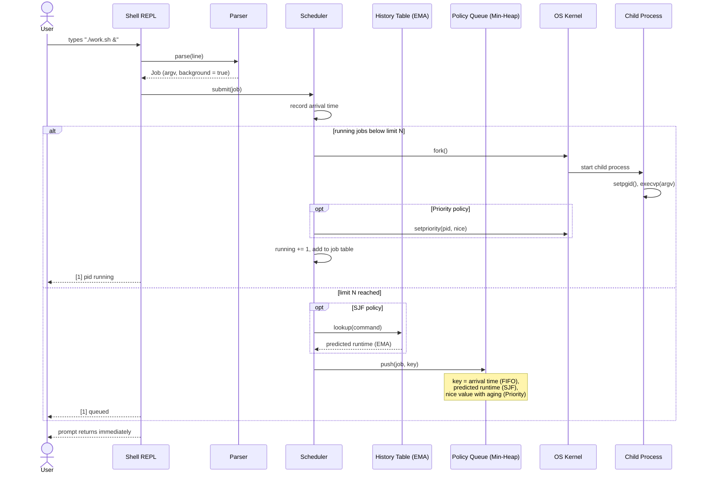
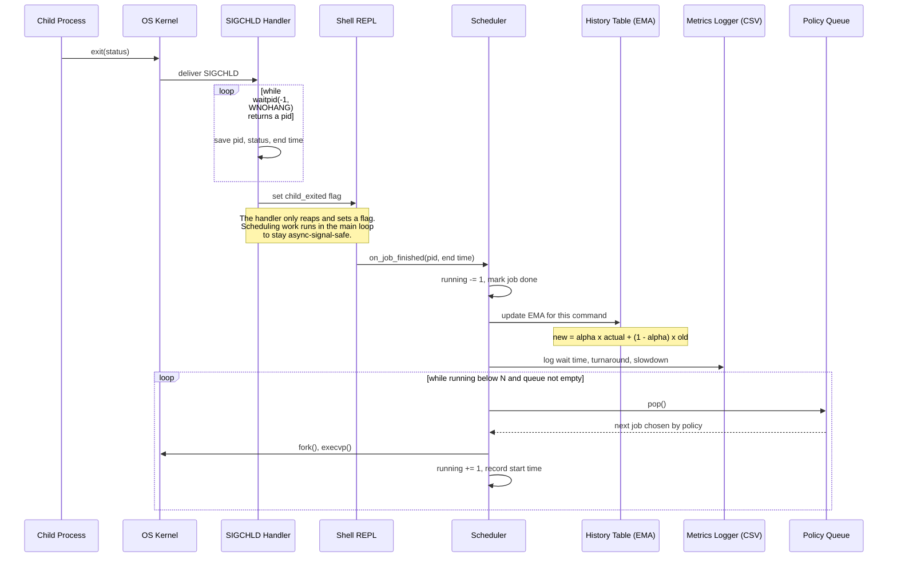
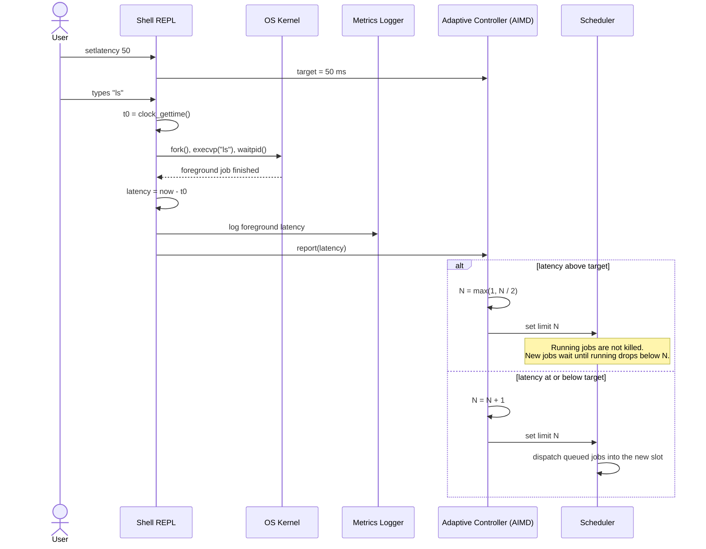

# SchedLab – System Architecture (Deliverable 4)

SchedLab extends a standard UNIX shell with a scheduling subsystem for background jobs. Instead of starting every `&` job immediately, the shell enforces a concurrency limit **N** (`setconcurrency N`) and uses a scheduling policy (FIFO, SJF, Priority, or Adaptive) to choose which queued job starts when a slot opens.

## Components

| Component | Responsibility |
|---|---|
| Shell REPL | Reads input, runs the main loop, handles foreground jobs and built-ins |
| Parser | Turns a command line into a job (argv, pipes, redirects, background flag) |
| Scheduler | Tracks running jobs, enforces limit N, dispatches queued jobs |
| Policy Queue | Min-heap keyed by arrival time (FIFO), predicted runtime (SJF), or nice value with aging (Priority) |
| History Table | Stores an EMA of past runtimes per command, used by SJF |
| SIGCHLD Handler | Reaps finished children with `waitpid(WNOHANG)` and notifies the main loop |
| Adaptive Controller | AIMD loop that adjusts N based on foreground latency vs. `setlatency` target |
| Metrics Logger | Writes foreground latency, wait time, and turnaround to CSV; backs the `stats` command |

## Critical Path 1: Submitting a Background Job

When the user starts a background job, the scheduler either launches it right away (a slot is free) or places it in the policy queue.

## Critical Path 2: Job Completion and Dispatch

When a background job exits, the shell reaps it, records its metrics, and fills the freed slot from the queue.

## Critical Path 3: Adaptive Concurrency Control (AIMD)

Under the Adaptive policy, every foreground command is timed, and the controller adjusts N toward the user's latency target, similar to TCP congestion control.

