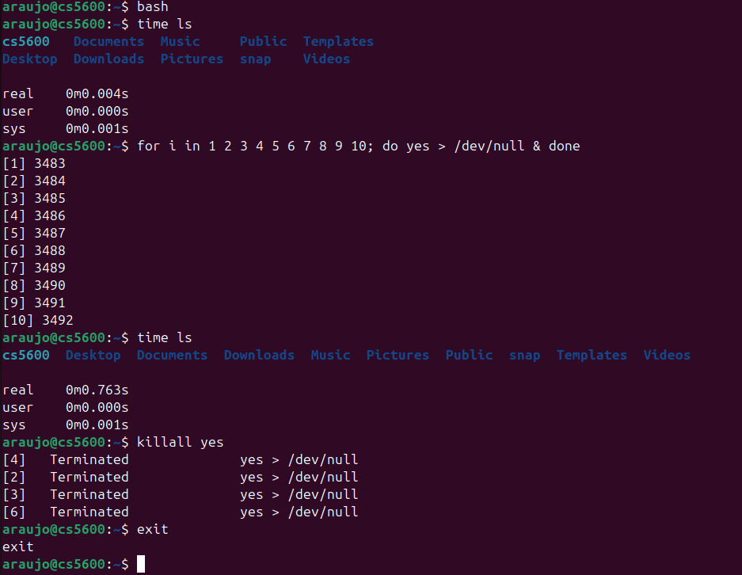
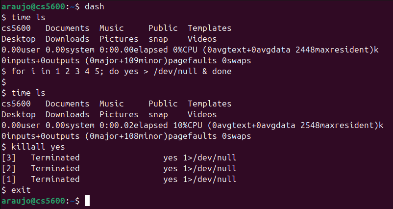
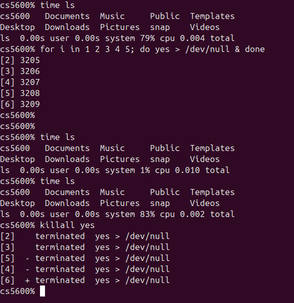

# UNIX Shell Exploration Report

## Introduction
For this exploration, we tested Bash, Dash, and Zsh in a Linux terminal using a set of basic commands to see how each shell handles command execution, piping, and output redirection. We used the same commands and inputs for all three shells to make the comparison fair.

## Bash, Dash, and Zsh

### Bash
Bash is widely used for interactive execution, scripting, pipes, and redirection. It also has command history and tab completion. For our test, we used `echo` to print text, `pwd` to show the current directory, and a pipe (`|`) with `tr` to convert lowercase letters to uppercase. We then redirected the output to `bash_test.txt` (`>`) and read it back with `cat`. All commands worked as expected.

### Dash
Dash is a minimal, POSIX-compliant shell designed for fast script execution. It has fewer interactive features than Bash. We tested Dash with the same commands. It successfully printed text, showed the directory, converted lowercase to uppercase through a pipe, and handled redirection. Despite being simpler, Dash performed the same as Bash for these basic operations.

### Zsh
Zsh is an advanced shell with customizable prompts and powerful completion. We used the same tests. Zsh executed commands, converted text through a pipe, and redirected output successfully. At the system-call level (`fork`, `execve`, `pipe`, `dup2`), its behavior mirrors Bash and Dash for basic pipelines.

## Comparison
All three shells completed the tests successfully. At the basic level, they behave the same: they parse commands, create pipes, and redirect file descriptors. The differences are in interactive features and memory footprint, not in basic process execution.

However, there is one shared limitation across all three shells: **none of them limit how many background jobs (`&`) run at once**. Every shell immediately forks and executes background jobs directly into the kernel run-queue. When many CPU-heavy jobs run, foreground commands become slow. This is the problem our project, SchedLab, addresses.

## Conclusion
This exploration helped us understand how standard shells execute commands and manage processes. Bash is best for general use, Dash is minimal and fast, and Zsh has advanced features. But none of them solve the background job problem. SchedLab will build on this foundation by adding a concurrency limit and scheduling policies to keep the foreground responsive.